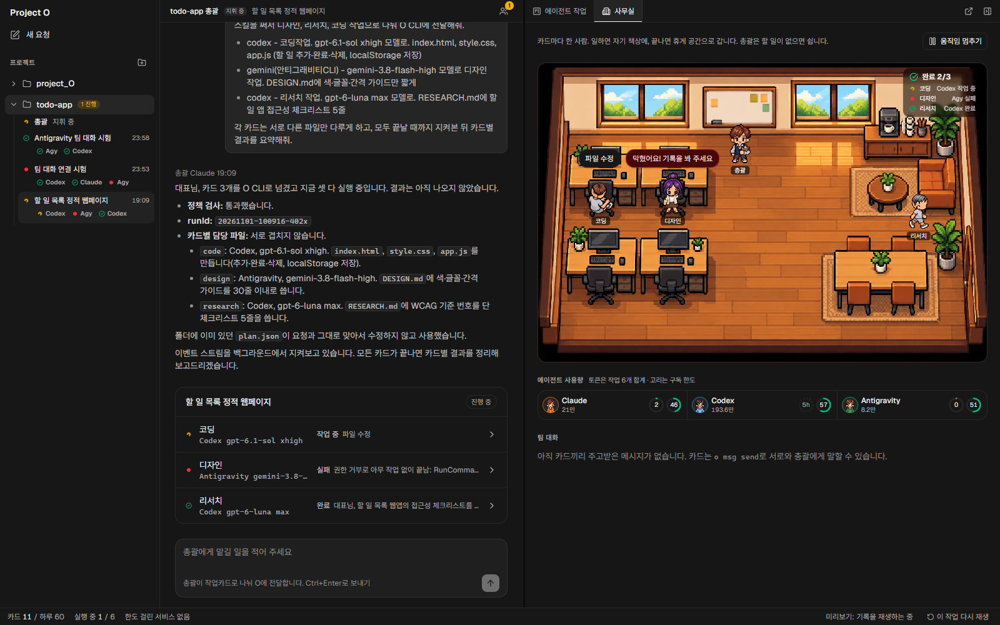

# project_O

여러 AI 코딩 에이전트와 구독 계정을 한 데스크톱 앱에서 실행하고(작업대), 돌고 있는 세션을 한 화면에서 관측하는(관제탑) 개인용 로컬 앱. 비유하면 Orca의 채팅 UI 버전.

> 상태: O CLI(작업카드 분배)·정책 자동 차단은 Rust(`o.exe`)로 동작. 화면은 Orca 디자인 시스템을 따른 React 앱으로, 개발 서버나 데스크톱 앱(`project_O.exe`, Tauri 2 셸)에서 이 PC의 실제 실행 기록을 보여 준다([ADR-0001](docs/decisions/0001-stack-tauri-rust-core.md)).



화면 캡처와 아키텍처 그림은 [docs/screenshots/](docs/screenshots/README.md).

## 구성

| 폴더 | 내용 |
|---|---|
| `crates/o-guard` | 프로바이더 정책 규칙, 에이전트 훅(`o hook`), 저장소 검사(`o scan`) |
| `crates/o-core` | 계획·이벤트·정책, 공식 CLI 실행과 스트림 해석, 실행 기록, 병렬 실행기, 사용량 조회 |
| `crates/o-cli` | `o` 명령 하나(`o.exe`) |
| `app/` | 화면 (Vite + React 19 + Tailwind 4). 기록 접기·다음 할 일 로직은 `src/core/*.ts` |
| `app/src-tauri` | 데스크톱 셸 (Tauri 2, 크레이트 `project-o` → `project_O.exe`). `o-core`를 직접 쓴다 |
| `skills/o/` | 총괄 에이전트가 쓰는 O 스킬 |

- 작업 규칙·브랜치 흐름·정책 차단: [AGENTS.md](AGENTS.md)
- 설계 초안: [docs/DESIGN.md](docs/DESIGN.md)
- 제품 목표와 현재 상태: [docs/GOALS.md](docs/GOALS.md)
- 결정 기록: [docs/decisions/](docs/decisions/)

## 시작하기

Rust(stable)와 Node.js 22.18 이상.

```sh
cargo install --path crates/o-cli   # o.exe 설치 (어디서나 `o`)
npm install                         # git 훅(.githooks → o scan) 연결
cargo test --workspace              # 정책·훅·실행기·스트림 해석·팀 대화 테스트
npm test                            # 화면 로직 테스트
o scan --all                        # 전체 파일 정책 검사
```

git 훅과 에이전트 훅은 PATH의 `o`를 부른다. `o`를 고친 뒤에는 `cargo install --path crates/o-cli`로 다시 설치한다.

## 화면 (app/)

```sh
cd app
npm install
npm run dev        # http://localhost:1430 — 이 PC의 O 실행 기록(없으면 기록 재생 데모)
npm run check      # TypeScript
```

### 데스크톱 앱 (project_O.exe)

`app/src-tauri`의 Tauri 2 셸. 같은 화면을 창 하나로 띄우고, 실행 기록·사용량·에이전트 CLI 상태를 `o-core`로 직접 읽는다(개발 서버의 `/api` 대신 Tauri 명령: `runs`, `usage`, `usage_refresh`, `agents_status`, `agent_install`, `agent_login`, `open_external`, `about`).

```sh
cd app
npm install
npm run tauri build -- --no-bundle   # 화면 빌드(dist) 후 target/release/project_O.exe
npm run tauri dev                    # 개발: http://localhost:1430 + 창
```

- 설치는 공식 npm 패키지(`npm install -g @anthropic-ai/claude-code`, `npm install -g @openai/%LOCALAPPDATA%/project_O-agents/<claude|codex|agy>/home`)가 있고 npm이 PATH에 있을 때만 앱에서 실행한다. Antigravity와 npm이 없을 때는 각 회사의 공식 설치 안내를 보여 준다(인터넷 스크립트를 앱이 받아 실행하지 않음).
- 로그인은 새 콘솔 창에서 공식 명령(`claude auth login`, `%LOCALAPPDATA%/project_O-agents/<claude|codex|agy>/home login`)을 띄운다. Antigravity는 시스템 로그인을 그대로 쓴다.
- 같은 동작을 CLI로: `o agents status [--clean] --json`, `o agents install <id>`, `o agents open-login <id> [--clean]`, `o about --json`.

`?source=demo`로 기록 재생, `?source=live`로 실시간을 고른다. 개발 서버의 `/api`는 `o runs --json`·`o usage`를 불러 쓰며 이 PC 주소·같은 출처 요청만 받는다.

Orca(MIT)의 디자인 시스템을 따른다: 토큰은 `app/src/styles/orca-theme.css`(원본 복사, 고치지 말고 다시 추출), Geist 글꼴, Tailwind 4, lucide 아이콘. 출처와 라이선스는 [THIRD_PARTY_NOTICES.md](THIRD_PARTY_NOTICES.md).

## O CLI

총괄 에이전트(예: Claude Code 세션)가 요청을 작업카드로 나눠 넘기면, O가 정책을 검사한 뒤 각 공식 CLI를 백그라운드에서 병렬로 실행한다. 어느 에이전트·모델로 할지는 총괄이 정한다.

```
사용자 ─▶ 총괄 Claude ─(O 스킬)─▶ o dispatch plan.json
                                   │ 정책 검사 (위반 시 전체 차단, 종료 코드 2)
                                   ├─▶ %LOCALAPPDATA%/project_O-agents/<claude|codex|agy>/home exec --json
                                   ├─▶ agy -p --output-format stream-json
                                   └─▶ claude -p --output-format stream-json
                                         ▼
                      %LOCALAPPDATA%/project_O/runs/<runId>/events.jsonl ─▶ 채팅·사무실·대시보드
```

실행마다 `events.jsonl`(추가만 하는 원본 기록)을 남기고, 화면과 `o status`는 `%LOCALAPPDATA%/project_O/o.db`(SQLite 색인)를 거쳐 읽는다. 색인은 읽을 때마다 새로 붙은 줄만 가져오고, 하루 실행 수·쿨다운·차단 기록도 여기에 둔다. 카드(에이전트 CLI)는 자기 실행 폴더에만 쓴다.

| 명령 | 하는 일 |
|---|---|
| `o check plan.json` | 정책 검사만 |
| `o dispatch plan.json` | 검사 후 백그라운드 실행, runId 출력 |
| `o status [runId]` | 카드별 상태 |
| `o events <runId> [--follow]` | 정규화 이벤트(JSONL) |
| `o stop <runId>` | 중지 |
| `o msg send / read / post` | 팀 대화: 카드끼리, 카드와 총괄(`lead`)이 메시지를 주고받음 |
| `o usage [--json] [--cached]` | Codex·Antigravity 구독 한도를 각 CLI로 조회 |
| `o runs --json` | 모든 실행 기록(화면용) |
| `o hook` / `o scan --all\|--staged\|--pre-push` | 에이전트 훅 / 정책 검사 |
| `o sync-mirror <폴더>` | 거울(팀은 `test_2`, `test_1`·`main`도 가능) fast-forward (예약 작업용) |
| `o agents path\|login\|shell\|doctor` | 깨끗한 에이전트 프로필 (아래) |
| `o agents status\|install\|open-login` / `o about` | 에이전트 CLI 설치·로그인 상태, 공식 설치·로그인 창 / 버전과 폴더 위치 (데스크톱 앱과 같은 동작) |

### 깨끗한 에이전트 (테스트용)

개인 하네스(사용자 훅·전역 AGENTS.md/CLAUDE.md·스킬·플러그인·MCP·메모리·사용자 설정)가 하나도 없는 공식 CLI를 평소 설정을 건드리지 않고 쓴다.

| 명령 | 하는 일 |
|---|---|
| `o agents path` | 프로필 위치: `%LOCALAPPDATA%/project_O-agents/<claude\|codex\|agy>/home` |
| `o agents login <claude\|%LOCALAPPDATA%/project_O-agents/<claude|codex|agy>/home\|agy>` | 그 프로필로 공식 로그인 (`claude auth login`, `codex login`). CLI마다 한 번. agy는 시스템 로그인을 그대로 써서 확인만 한다 |
| `o agents shell <claude\|%LOCALAPPDATA%/project_O-agents/<claude|codex|agy>/home\|agy> [인자…]` | 지금 폴더에서 깨끗한 CLI를 대화형으로 실행 |
| `o agents doctor [--json]` | 로그인 상태와 프로필 오염(훅·스킬·MCP·전역 지시) 검사. 깨끗하면 종료 코드 0 |
| `o dispatch --clean plan.json` | 이 실행의 카드를 깨끗한 프로필로 실행 (계획 형식은 그대로) |

깨끗한 실행은 환경변수를 시스템 기본값(PATH, SystemRoot, TEMP, APPDATA, LOCALAPPDATA, ProgramFiles 등)만 남기고 비운 뒤 홈(USERPROFILE/HOME)을 프로필로 바꾸고, Claude는 `CLAUDE_CONFIG_DIR`, Codex는 `CODEX_HOME`을 프로필 안으로 둔다. Claude는 시작 폴더 위의 지시 파일도 읽으므로 프로필 설정(`claudeMdExcludes`)이 홈 폴더의 AGENTS.md·CLAUDE.md를 뺀다. 그 밖의 상위 폴더 지시 파일은 `doctor`가 알려 준다 — 테스트 프로젝트는 홈 폴더 밖에 둔다. Orca 터미널은 자체 훅을 더하므로 `o agents shell`이나 일반 터미널을 쓴다.

계획 형식과 총괄 에이전트 사용법은 [skills/o/SKILL.md](skills/o/SKILL.md). Claude Code에서 쓰려면 이 폴더를 `~/.claude/skills/o`로 복사하거나 링크한다.
