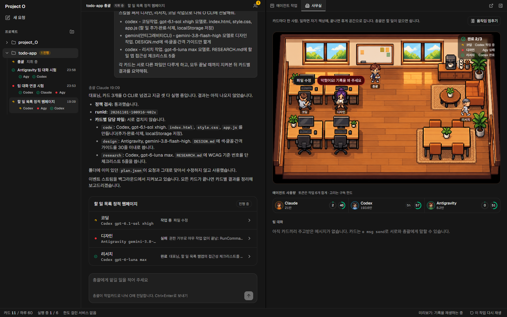

한국어 문서: [README.ko.md](README.ko.md)

# project_O

A personal, local-only desktop app and `o` CLI for Windows that runs official AI coding-agent CLIs (Claude Code, Codex and others) under your own logins in one place — the workbench — and keeps every running session observable on a single screen — the control tower. In one line: Orca's chat UI, pointed at the agents you already pay for.

> A personal project, not affiliated with Anthropic, OpenAI, Google or Cognition. Claude, Codex, Gemini, Antigravity, Devin and other product names are trademarks of their respective owners.

> Status: the O CLI (work-card dispatch) and the automatic policy block run in Rust (`o.exe`). The screens are a React app built on the Orca design system and show this PC's real run records from either the dev server or the desktop app (`project_O.exe`, a Tauri 2 shell) ([ADR-0001](docs/decisions/0001-stack-tauri-rust-core.md)).



*The screen as it was before Antigravity execution was held ([ADR-0020](docs/decisions/0020-antigravity-policy.md)).* Screenshots and architecture diagrams: [docs/screenshots/](docs/screenshots/README.md).

## Before you start

- **Your own subscription, the official CLIs.** O runs each provider's official CLI (`claude`, `codex`, …) with the login you already made yourself. The subscription and the login are yours, and so is the responsibility for following each provider's terms of service and usage policies. O does not read or copy login files or tokens, and does not call provider servers directly. There is no way to register several accounts for one service and switch between them, and a service that hit its limit is blocked from being used again through another account, too. Antigravity is not run, following the provider's policy ([ADR-0020](docs/decisions/0020-antigravity-policy.md)).
- **YOLO mode.** Off by default. When you turn it on, the lead and the cards are given each CLI's official option that disables its permission prompts, so agents edit files and run commands without asking ([ADR-0014](docs/decisions/0014-yolo-mode.md)). Turn it on only for projects you trust.
- **Scheduled runs.** Only schedules you create run, through the Windows Task Scheduler, even while the app is closed. The lead runs read-only and cards run with normal permissions, and a run is dispatched only if it passes the daily usage budget and the automatic-run limit ([ADR-0019](docs/decisions/0019-navigation-images-schedules.md)).
- **Supported operating systems.** Windows x64. macOS (Apple Silicon) is experimental and has to be built from source: it was checked on real hardware only once, with Codex only, and no distribution file exists ([ADR-0030](docs/decisions/0030-macos-owned-worker-observation.md), [verification record](docs/macos-verification-2026-11-05.md)). Scheduled runs work on Windows only. The app is not supported on Linux.

## Install

Download `project_O_<version>_x64-setup.exe` from [Releases](https://github.com/chan12392/project_O/releases). A `test_1-<date>-<commit>` tag is a prerelease (test build) that `release.yml` creates automatically from the `test_1` branch. The installer is not code signed, so the first start shows SmartScreen's "unknown publisher". Install the agent CLIs (Claude Code, Codex) separately and log in with each CLI's own official command — the app's first-run guide helps. Install folder, uninstall and update notices: [docs/INSTALL.md](docs/INSTALL.md).

## Security model (summary)

- **O guard.** Agent hooks (`o hook`, wired as Claude Code and Codex project hooks), git hooks (`o scan`) and CI apply the same rules to block access to credential files and tokens, direct calls to provider servers, options that disable a CLI's permission prompts, and commits or pushes on protected branches. The rules themselves are in `crates/o-guard/src/rules.rs`.
- **Policy limits.** `o dispatch` and the app do not let a card choose its executable, arguments, environment variables or account, and they refuse to dispatch a plan that exceeds the limits: 6 concurrent runs, 60 cards a day, a cooldown after a provider hits its limit, and the daily usage budget (`crates/o-core/src/policy.rs`). There is no way to raise a limit through settings or environment variables.
- **A person approves.** In the default mode the lead only reads and searches immediately; file edits, command execution and web requests each have to be allowed by a person in the app. The lead's plan is dispatched only after a person presses "run" (exceptions: scheduled runs, and follow-up instructions to work that was already approved — [ADR-0022](docs/decisions/0022-agent-session-continuations.md)).
- **What it cannot stop.** O is not a security sandbox. A program running with the same Windows user rights can erase O's markers or start a separate process and get around it. Under YOLO the O guard hook is injected into Claude only; the same hook has not been confirmed for Codex. Use each CLI's own sandbox and permission settings alongside O.

The full table is in [AGENTS.md](AGENTS.md) ("프로바이더 정책 자동 차단"). Report security problems through the method in [SECURITY.md](SECURITY.md), not in a public issue.

## Contributing

How to contribute from outside, the development environment and the check commands: [CONTRIBUTING.md](CONTRIBUTING.md) (한국어: [CONTRIBUTING.ko.md](CONTRIBUTING.ko.md)). The team's branch and merge rules are in [AGENTS.md](AGENTS.md).

## Layout

| Folder | Contents |
|---|---|
| `crates/o-guard` | Provider policy rules, agent hook (`o hook`), repository scan (`o scan`) |
| `crates/o-core` | Plans, events and policy; running the official CLIs and parsing their streams; run records; the parallel runner; usage lookups |
| `crates/o-cli` | The single `o` command (`o.exe`) |
| `app/` | Screens (Vite + React 19 + Tailwind 4). Record folding and next-step logic live in `src/core/*.ts` |
| `app/src-tauri` | Desktop shell (Tauri 2, crate `project-o` → `project_O.exe`). Uses `o-core` directly |
| `skills/o/` | The O skill the lead agent uses |

- Team rules, branch flow and policy blocks (for team members and agents): [AGENTS.md](AGENTS.md)
- How to contribute: [CONTRIBUTING.md](CONTRIBUTING.md)
- Module structure, data flow, checklist for adding a feature: [docs/ARCHITECTURE.md](docs/ARCHITECTURE.md)
- Design draft: [docs/DESIGN.md](docs/DESIGN.md)
- Product goals and current state: [docs/GOALS.md](docs/GOALS.md)
- Decision records: [docs/decisions/](docs/decisions/)

## Getting started

Rust (stable) and Node.js 22.18 or later.

```sh
cargo install --path crates/o-cli   # install o.exe (`o` from anywhere)
npm install                         # wire up the git hooks (.githooks → o scan)
cargo test --workspace              # policy, hooks, runner, stream parsing, team chat tests
npm test                            # screen logic tests
o scan --all                        # policy scan over every file
```

The git hooks and the agent hooks call the `o` on your PATH. After changing `o`, reinstall it with `cargo install --path crates/o-cli`.

## Screens (`app/`)

```sh
cd app
npm install
npm run dev        # http://localhost:1430 — this PC's O run records (replays demo records when there are none)
npm run check      # TypeScript
```

### Desktop app (`project_O.exe`)

The Tauri 2 shell in `app/src-tauri`. It shows the same screens in a window and reads run records, usage and agent CLI state directly through `o-core`, using Tauri commands instead of the dev server's `/api`: `runs`, `usage`, `usage_refresh`, `agents_status`, `agent_install`, `agent_login`, `agent_setup`, `open_external`, `about`, `review`.

```sh
cd app
npm install
npm run tauri build -- --no-bundle   # builds the screens (dist), then target/release/project_O.exe
npm run tauri dev                    # dev: http://localhost:1430 + window
```

Windows installer (NSIS, includes `o.exe`): [docs/INSTALL.md](docs/INSTALL.md) — `pwsh scripts/build-installer.ps1`, or the `test_1` prerelease.

- Installing an agent runs the official npm package from the app (`npm install -g @anthropic-ai/claude-code`, `npm install -g @openai/codex`) only when the package exists and npm is on the PATH. Without npm it opens each company's official install instructions.
- Logging in opens the official command in a new console window (`claude auth login`, `codex login`). Antigravity is not run from Project O, following the provider's policy.
- Codex in the project_O profile has to pass a Windows sandbox check before it takes cards. Until then no Codex card starts; "Codex sandbox check" in the app (`o agents setup codex`) completes Codex's official sandbox setup without a window, then actually runs one command the way a card would (one model call). The record has to be checked again when the Codex version or the profile settings change (ADR-0040, revision 1).
- The same actions from the CLI: `o agents status [--clean] --json`, `o agents install <id>`, `o agents open-login <id> [--clean]`, `o agents setup codex`, `o about --json`.

`?source=demo` replays records and `?source=live` picks the live ones. The dev server's `/api` shells out to `o runs --json` and `o usage`, and accepts only this PC's address and same-origin requests.

The design system follows Orca (MIT): the tokens are in `app/src/styles/orca-theme.css` (a verbatim copy — do not edit it, extract it again instead), with the Geist font, Tailwind 4 and lucide icons. Sources and licences: [THIRD_PARTY_NOTICES.md](THIRD_PARTY_NOTICES.md).

The project's licence is [Apache-2.0](LICENSE). Third-party components keep their own licences.

## O CLI

The lead agent (for example a Claude Code session) splits a request into work cards and hands them over; O checks the policy and then runs each official CLI in the background, in parallel. The lead decides which agent and model does which card.

```
user ─▶ lead Claude ─(O skill)─▶ o dispatch plan.json
                                   │ policy check (any violation blocks the whole plan, exit code 2)
                                   ├─▶ codex exec --json
                                   └─▶ claude -p --output-format stream-json
                                         ▼
                      %LOCALAPPDATA%/project_O/runs/<runId>/events.jsonl ─▶ chat · office · dashboard
```

Every run leaves an `events.jsonl` (an append-only source record), and the screens and `o status` read it through `%LOCALAPPDATA%/project_O/o.db` (a SQLite index). The index fetches only the lines appended since the last read, and it also holds the day's run count, the cooldown and the blocked records. A card (an agent CLI) writes only inside its own run folder.

| Command | What it does |
|---|---|
| `o check plan.json` | Policy check only |
| `o dispatch [--profile project-o\|own] [--no-context] plan.json` | Checks, then runs in the background and prints the runId. The default is the project_O profile (clean agents); `own` uses this PC's usual CLI settings ([ADR-0013](docs/decisions/0013-profile-and-budget-switches.md)) |
| `o status [runId]` | Per-card status |
| `o events <runId> [--follow]` | Normalised events (JSONL) |
| `o stop <runId>` | Stop a run |
| `o msg send / read / post` | Team chat: cards message each other and the lead (`lead`) |
| `o review <PR number\|URL> [--provider P] [--model M] [--effort E] [--profile project-o\|own] [--post] [--dry-run]` | Reads a PR of the repository in the current folder with `gh` and reviews it as one card (no file changes). `--post` posts the review as a PR comment — it does not approve or merge ([ADR-0006](docs/decisions/0006-pr-cross-review.md)) |
| `o usage [--json] [--cached]` | Subscription limits for the supported CLIs (Antigravity lookup held) |
| `o budget [--json] [--cached] [--percent 12\|13\|14] [--on\|--off]` | Each agent's daily usage budget (12–14% of the weekly limit), speed and effort adjustment, budget on and off (below) |
| `o runs --json` | Every run record (for the screens) |
| `o hook` / `o scan --all\|--staged\|--pre-push` | Agent hook / policy scan |
| `o sync-mirror <folder>` | Fast-forwards a mirror (the team uses `test_2`; other protected branches work too) — for the scheduled task |
| `o agents path\|login\|shell\|doctor` | Clean agent profiles (below) |
| `o agents status\|install\|open-login\|setup` / `o about` | Agent CLI install and login state, official install and login windows, profile setup and checks (Codex sandbox) / version and folder locations (the same actions as the desktop app) |

### Daily usage budget ([ADR-0004](docs/decisions/0004-daily-usage-budget.md), [ADR-0013](docs/decisions/0013-profile-and-budget-switches.md))

Each agent (provider) spends, per day, only 13% of its weekly (`seven_day`) limit — set in Settings → Agents, or with `o budget --percent 12|13|14`; the value is `dailyBudgetPercent` in `%LOCALAPPDATA%/project_O/settings.json`.

- Used today = the weekly usage rate now minus the weekly usage rate at 0:00 today. It is computed from the snapshots O writes to `usage_snapshots` in `o.db` every time usage is read (`o usage`, the app's refresh, `o budget`, the lookup right before a run, the reports during a Claude run). If the weekly limit reset today, counting starts at the reset.
- The speed is checked right before a card starts. If the remaining budget ratio is smaller than the remaining time ratio (until midnight, or until the weekly reset when that comes first), effort is lowered one step; if it is smaller than half of it, two steps. It is never lowered below `low` and never raised. A card without effort is treated as `medium` and lowered. The change is recorded as a `card.budget` event; plan.json stays as it was.
- No new card goes to an agent whose budget is spent (policy `daily-budget`). An agent without a weekly record is not adjusted.
- It can be turned off (Settings → Agents → daily usage budget, `o budget --off`; `dailyBudgetEnabled` in `settings.json`). With the budget off, nothing is blocked and no effort is lowered for it, and the number and the "today" ring read "budget off". Subscription limits, cooldown and `LIMITS` are unchanged.
- `o _run` first refreshes the stored record of a supported provider when it is more than 10 minutes old. `o dispatch` does not refresh and checks against the stored record.

### Clean agents (for testing)

An official CLI with none of your personal harness — user hooks, global `AGENTS.md`/`CLAUDE.md`, skills, plugins, MCP servers, memory, user settings — used without touching your usual setup.

| Command | What it does |
|---|---|
| `o agents path` | Profile location: `%LOCALAPPDATA%/project_O-agents/<claude\|codex\|agy>/home` |
| `o agents login <claude\|codex\|opencode>` | Official login into that profile. Once per CLI |
| `o agents shell <claude\|codex\|opencode> [args…]` | Runs the clean CLI interactively in the current folder |
| `o agents doctor [--json]` | Checks login state and profile contamination (hooks, skills, MCP, global instructions). Exit code 0 when clean |
| `o dispatch plan.json` (`--profile project-o`, same as `--clean`) | Runs this run's cards with the clean profile (the plan format is unchanged). This is the app's "use the project_O profile" |

A clean run empties the environment down to the system defaults (PATH, SystemRoot, TEMP, APPDATA, LOCALAPPDATA, ProgramFiles and so on), points home (USERPROFILE/HOME) at the profile, and puts `CLAUDE_CONFIG_DIR` for Claude and `CODEX_HOME` for Codex inside the profile. Claude also reads instruction files in the folders above its start folder, so the profile settings (`claudeMdExcludes`) drop the `AGENTS.md`/`CLAUDE.md` in the home folder. Other instruction files higher up are reported by `doctor` — keep test projects outside the home folder. Orca terminals add their own hooks, so use `o agents shell` or an ordinary terminal instead.

The plan format and how the lead agent uses it are in [skills/o/SKILL.md](skills/o/SKILL.md). To use it from Claude Code, copy or link this folder to `~/.claude/skills/o`.
